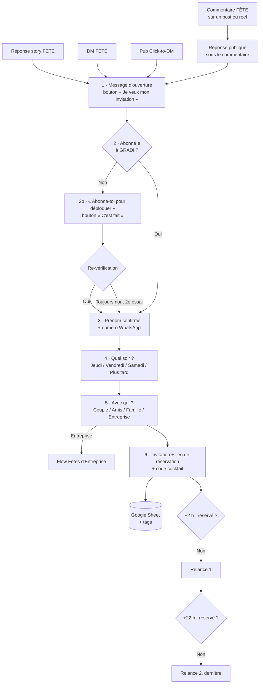

# GRADI — Séquence ManyChat « FÊTE » (Big Opening 5 · 6 · 7 novembre)

Guide de montage pas à pas pour **ManyChat Pro** connecté au compte Instagram professionnel
de GRADI. Tous les messages sont prêts à copier-coller. Ton : tutoiement en DM, émojis 🌙 ✦ 🥂
seulement (charte graphique).

> **Rappel important.** Instagram ne permet pas d'envoyer un DM automatique au moment où
> quelqu'un s'abonne. La séquence fonctionne donc dans l'autre sens : la personne commente
> **FÊTE**, reçoit le DM, et **on lui demande de s'abonner pour débloquer l'invitation**.
> Résultat : un nouvel abonné + un contact + une réservation, dans la même conversation.

---

## Vue d'ensemble

---

## 0 · Préparation (10 min, une seule fois)

### Champs personnalisés (Settings → Fields → User Fields)
| Nom | Type | Usage |
|-----|------|-------|
| `soir_choisi` | Texte | Jeudi 5 / Vendredi 6 / Samedi 7 / Plus tard |
| `type_groupe` | Texte | Couple / Amis / Famille / Entreprise |
| `numero_liste` | Nombre | Numéro sur la Liste Privée |
| `source` | Texte | commentaire / story / dm / pub |
| `consentement_whatsapp` | Texte | Date + heure de l'accord |

### Champ du compte (Settings → Fields → Bot Fields)
| Nom | Type | Valeur de départ |
|-----|------|------------------|
| `compteur_liste` | Nombre | Le nombre d'inscrits actuel (ou 0) |

### Tags (Settings → Tags)
`fete_lead` · `abonne_verifie` · `whatsapp_ok` · `reserve` · `soir_jeudi` · `soir_vendredi` ·
`soir_samedi` · `soir_plus_tard` · `b2b` · `besoin_humain`

### Liens à préparer
- Lien de réservation avec suivi : `[LIEN_RESERVATION]?utm_source=instagram&utm_medium=dm&utm_campaign=big_opening`
- Lien Google Maps : `https://maps.google.com/?q=Route+de+la+Galaise+24,+1228+Plan-les-Ouates`

---

## 1 · Le déclencheur : commentaire « FÊTE »

**Automation → New Automation → Instagram → « User comments on your Post or Reel »**

| Réglage | Valeur |
|---------|--------|
| Quel post ? | **Any post or reel** (tous les posts, y compris les prochains) |
| Le commentaire contient | `FÊTE`, `FETE`, `fête`, `fete`, `Fête`, `Fete`, `🌙` |
| Réponse publique au commentaire | **Activée**, avec les 4 variantes ci-dessous (ManyChat les fait tourner) |
| Exclure les mentions (@) | Activé |

**Réponses publiques (à coller dans les variantes) :**
1. `C'est dans tes DM 🌙`
2. `Ton invitation t'attend en message ✦`
3. `Regarde tes messages, on t'a gardé une place 🥂`
4. `Envoyé ! Check tes DM ✦`

**Autres portes d'entrée vers le même flow** (créer une automation pour chacune et la relier à l'étape 1) :
- **Story reply** : « User replies to your Story », mot-clé FÊTE (toutes les stories)
- **DM keyword** : « User sends a message », mot-clé FÊTE
- **Pub Click-to-DM** : « Instagram Ads » → bouton « Je veux mon invitation »
- Dans chaque automation, action **Set field** `source` = commentaire / story / dm / pub

---

## 2 · Message d'ouverture (obligatoire avec un bouton)

Instagram exige que la personne **appuie sur un bouton** avant qu'on puisse lui écrire la suite.
Ce premier message doit donc être court et donner envie de cliquer.

> **Message 1**
> Bonsoir {{first name}} 🌙
>
> Merci pour ton commentaire ! GRADI ouvre ses portes cette semaine, **jeudi 5, vendredi 6 et
> samedi 7 novembre** à Plan-les-Ouates.
>
> Je t'envoie ton invitation : **cocktail de bienvenue offert** + accès à la réservation ?
>
> **[ Oui, je veux mon invitation ✦ ]**

Actions au clic : **Add tag** `fete_lead` → étape 3.

---

## 3 · Vérification de l'abonnement (le « follow-gate »)

Bloc **Condition** → *Instagram : Is following your account* (« Suit votre compte »).
Dans certaines versions de ManyChat, c'est l'option **« Ask to follow »** directement dans
l'automation de commentaire : l'activer revient au même.

**Si OUI** → **Add tag** `abonne_verifie` → étape 4.

**Si NON :**

> **Message 2b**
> Dernière petite étape avant ton invitation 🔓
>
> Abonne-toi à **@[HANDLE]** (c'est là qu'on annonce les soirées, la musique et les surprises),
> puis appuie sur le bouton 👇
>
> **[ C'est fait ✅ ]**

Au clic → **retour à la Condition**.
- Si toujours NON au **2e essai** : continuer quand même vers l'étape 4 (on ne perd pas le
  contact pour un abonnement). Ajouter le tag `abonnement_a_relancer`.

> **Message 2c** (2e essai, toujours non abonné·e)
> Je ne te vois pas encore dans nos abonnés, ça peut prendre une minute 😉
> On continue quand même, je ne vais pas te faire attendre !

---

## 4 · Récupérer le numéro WhatsApp

> **Message 3**
> Parfait {{first name}} ✦
>
> À quel numéro WhatsApp je t'envoie ton invitation et ton code cocktail ?
> _(On l'utilise uniquement pour GRADI : invitations et soirées. Tu peux te désinscrire à tout
> moment en répondant STOP.)_

Bloc **User Input** :
| Réglage | Valeur |
|---------|--------|
| Type de réponse | **Phone** |
| Enregistrer dans | System field **Phone** |
| Bouton rapide | `Je préfère l'email` → User Input type **Email** (System field Email) |
| Message si format invalide | `Hmm, ce numéro ne passe pas. Essaie au format +41 79 123 45 67 🙏` |
| Bouton pour passer | `Passer` (on continue sans numéro, tag `sans_contact`) |

Actions après réponse valide :
- **Add tag** `whatsapp_ok`
- **Set field** `consentement_whatsapp` = `{{current date}} {{current time}}`

---

## 5 · Quel soir ?

> **Message 4**
> Tu viendrais quel soir ?
>
> **[ Jeudi 5 · Opening Night ]**
> **[ Vendredi 6 ]**
> **[ Samedi 7 ]**
> **[ Plus tard en novembre ]**

Chaque bouton : **Set field** `soir_choisi` + **Add tag** `soir_jeudi` / `soir_vendredi` /
`soir_samedi` / `soir_plus_tard` → étape 6.

---

## 6 · Avec qui ?

> **Message 5**
> Et tu viens…
>
> **[ En couple 🌙 ]** **[ Entre amis 🥂 ]** **[ En famille ]** **[ Pour une fête d'entreprise ]**

- Couple / Amis / Famille → **Set field** `type_groupe` → étape 7
- **Entreprise** → **Add tag** `b2b` → **Start another flow** : « Fêtes d'Entreprise »
  (Flow B de `dm-automation.md`) + **Notify admin** (Valbon) avec prénom, téléphone, soir choisi

---

## 7 · L'invitation (le message le plus important)

Actions avant le message :
1. **Increment** bot field `compteur_liste` de **+1**
2. **Set field** `numero_liste` = `{{compteur_liste}}`
3. **Google Sheets → Insert row** (feuille « Leads GRADI ») : prénom, @instagram, téléphone,
   email, soir_choisi, type_groupe, source, numero_liste, date

> **Message 6**
> C'est noté {{first name}} ✦ Bienvenue sur la **Liste Privée GRADI**, tu es le n° {{numero_liste}}.
>
> 🎟️ **Ton invitation**
> ✦ 1 cocktail de bienvenue offert (montre ce message à l'accueil)
> ✦ Code : **FETE-{{numero_liste}}**
> ✦ Valable du 5 novembre au 31 décembre
>
> 📍 Route de la Galaise 24, 1228 Plan-les-Ouates
>
> Les tables partent vite pour le Big Opening. Réserve la tienne maintenant 👇
>
> **[ Réserver ma table ]** → `[LIEN_RESERVATION]` (bouton URL)
> **[ Voir l'adresse sur la carte ]** → lien Google Maps
> **[ J'ai une question ]** → étape 9

**Variante si `soir_plus_tard`** : remplacer la phrase des tables par
« On te prévient en avant-première pour les prochaines soirées. En attendant, tu peux déjà
réserver quand tu veux 👇 ».

Au clic sur **Réserver ma table** : **Add tag** `reserve_clic`.
Si l'outil de réservation peut renvoyer l'info (Zapier / webhook), mettre le tag `reserve`
quand la réservation est confirmée : ça arrête les relances.

---

## 8 · Les relances (dans la fenêtre de 24 h d'Instagram)

Après le message 6 : **Smart Delay 2 heures** → **Condition** : n'a PAS le tag `reserve_clic`
ni `reserve`.

> **Relance 1 (+2 h)**
> {{first name}}, petite info : il reste encore quelques tables pour {{soir_choisi}} 🌙
> Ton cocktail t'attend, il ne manque plus que ta réservation.
>
> **[ Réserver ma table ]**

**Smart Delay 20 heures** → même condition.

> **Relance 2 (+22 h, dernière)**
> Dernier message de ma part, promis ✦
> Le Big Opening, c'est jeudi, vendredi et samedi. Le dîner, puis la musique, puis la piste.
> Si tu veux une table, c'est ici 👇
>
> **[ Réserver ma table ]** **[ Pas cette fois ]**

« Pas cette fois » → **Add tag** `pas_maintenant` + message :
« Aucun souci {{first name}} ! Ton cocktail reste valable jusqu'au 31 décembre. À bientôt chez GRADI 🌙 »

Après 24 h, Instagram n'autorise plus les messages promotionnels automatiques. La suite se fait
sur **WhatsApp** (contacts tagués `whatsapp_ok`) : rappel le jour J, puis offres de décembre et
Nouvel An (voir `lead-magnet.md`).

---

## 9 · Questions et passage à un humain

> **Message « J'ai une question »**
> Bien sûr ! Écris ta question ici, quelqu'un de l'équipe te répond très vite ✦
>
> 🕖 Horaires : [HORAIRES]
> 📍 Route de la Galaise 24, 1228 Plan-les-Ouates

Actions : **Add tag** `besoin_humain` → **Pause automation 24 h** → **Notify admin** (Live Chat).
Règle d'équipe : réponse en moins de **15 minutes** entre 10h et 23h.

**Réponse par défaut** (Automation → Default Reply, si quelqu'un écrit autre chose) :
> Bonsoir 🌙 Merci pour ton message ! Que puis-je faire pour toi ?
> **[ Mon invitation ✦ ]** → étape 2 **[ Réserver une table ]** **[ Parler à l'équipe ]** → étape 9

---

## 10 · Pour les nouveaux abonnés (sans commentaire)

Comme Instagram ne déclenche rien au moment de l'abonnement, on les fait entrer dans la
séquence de deux façons :

**a) Message de bienvenue manuel (tous les soirs, 20–30 personnes max)**
Ouvrir la liste des nouveaux abonnés et envoyer à la main :
> Hello {prénom} 👋 Merci pour l'abonnement ! On ouvre GRADI ce jeudi à Plan-les-Ouates.
> Réponds juste **FÊTE** ici et je t'envoie ton invitation avec un cocktail offert 🌙

Sa réponse « FÊTE » déclenche automatiquement toute la séquence (déclencheur DM keyword).
Varier un peu le texte d'une personne à l'autre pour rester naturel.

**b) Ice breakers** (Settings → Instagram → Conversation Starters), visibles dès qu'un nouvel
abonné ouvre la conversation :
1. `🌙 Je veux mon invitation` → étape 2
2. `🥂 Réserver une table` → lien de réservation
3. `🏢 Fête d'entreprise` → Flow Fêtes d'Entreprise
4. `📍 Adresse et horaires` → étape 9

**c) Rappels dans le contenu** : bio, stories et chaque légende disent « Commente ou écris
FÊTE ».

---

## 11 · Checklist avant d'activer (à faire aujourd'hui)

- [ ] ManyChat Pro connecté au compte Instagram **professionnel**, et « Autoriser l'accès aux
      messages » activé dans Instagram → Paramètres → Messages
- [ ] Remplacer `[HANDLE]`, `[LIEN_RESERVATION]`, `[HORAIRES]`
- [ ] Champs, tags et Google Sheet créés (section 0)
- [ ] Tester depuis un compte perso **non abonné** : commentaire FÊTE → réponse publique → DM →
      demande d'abonnement → numéro → soir → groupe → invitation
- [ ] Tester avec « Fete » sans accent et « fête » en minuscules
- [ ] Vérifier qu'une ligne apparaît dans le Google Sheet
- [ ] Vérifier que la notification B2B arrive bien à Valbon
- [ ] Briefer l'accueil : le code **FETE-xxx** = 1 cocktail offert, à noter sur la table

## Chiffres à suivre chaque matin
| Indicateur | Objectif |
|------------|----------|
| Commentaires FÊTE → clic sur le 1er bouton | > 70 % |
| Non-abonnés → abonnés après le follow-gate | > 60 % |
| Clic → numéro WhatsApp laissé | > 55 % |
| Invitation → clic « Réserver ma table » | > 35 % |
